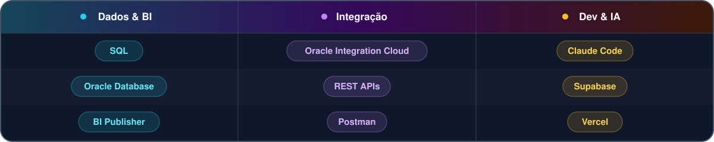

  

  
  
  

## 🧭 Sobre mim

> Eu uno **dados**, **integração** e **IA** para tirar ideias do papel.

- 📊 Trabalho com **BI e integração de sistemas**, com foco em **SQL**.
- 🔗 Conecto aplicações com o **Oracle Integration Cloud**.
- 🚀 Crio **sites e aplicativos** com o **Claude Code**.

## 📈 Meus commits

## 🛠️ Stack

## ⭐ Projeto em destaque

## 🔌 Oracle Integration Cloud

Com o **OIC** é possível:
- **Conectar sistemas** em nuvem e on-premises (ERP, HCM, CRM, bancos de dados) com adaptadores prontos.
- **Orquestrar processos** de ponta a ponta, disparados por eventos ou agendamentos.
- **Expor e consumir APIs REST/SOAP**, com mapeamento visual de dados.
- **Automatizar cargas** entre aplicações, com monitoramento e tratamento de erros.

## 🤝 Time do Claude Code

Eu defino o problema e as regras de negócio, e a IA acelera a construção. Assim, ideias viram produtos em dias, não em meses.

## 📫 Vamos conversar?

  
  
  

